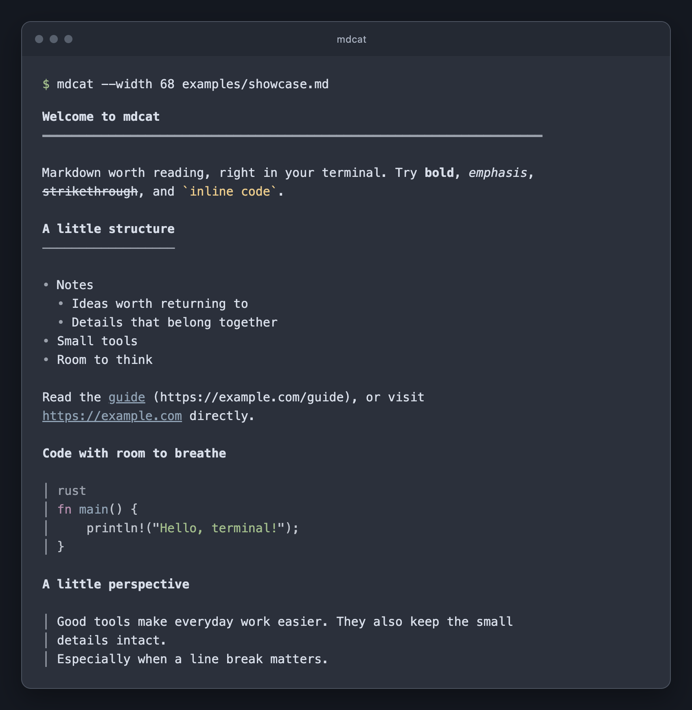
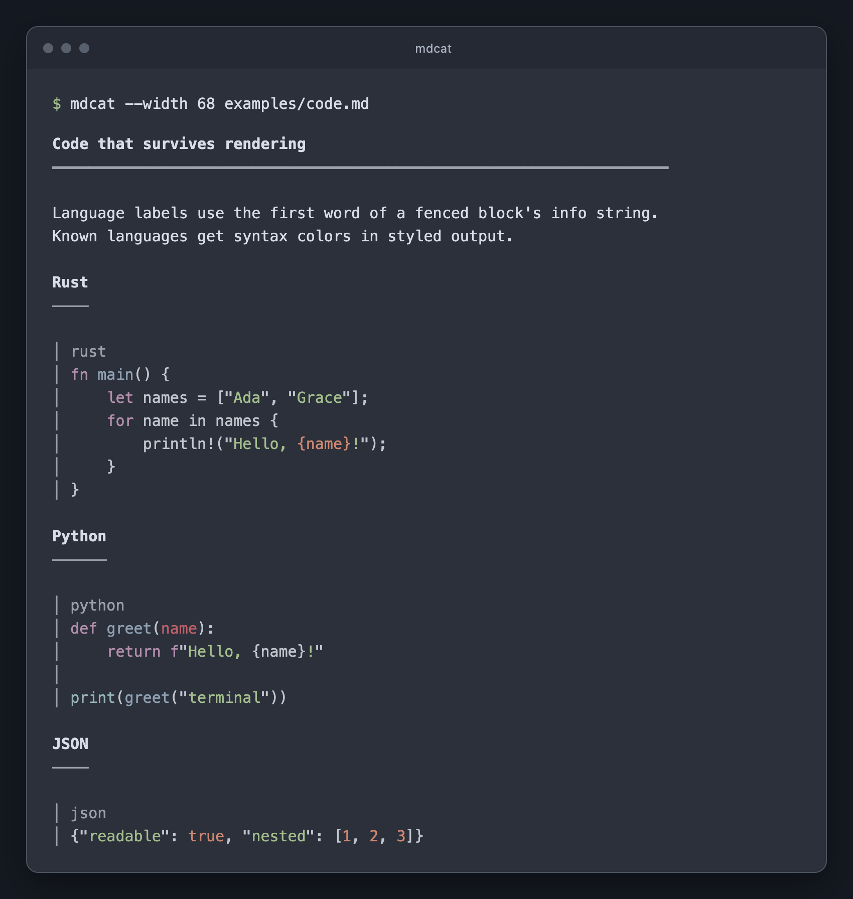

# mdcat

[](https://github.com/corywilkerson/mdcat/actions/workflows/ci.yml)

Readable Markdown in your terminal: clear headings, nested lists, quoted text,
aligned tables, and syntax-highlighted code. Read a file or pipe text in; pipes
get plain output automatically.

```sh
mdcat README.md
cat notes.md | mdcat --width 72
mdcat --color always examples/showcase.md | less -R
```



Syntax-highlighted code, with indentation and blank lines preserved:



## Install

Requires Rust 1.85 or newer and Cargo.

```sh
cargo install --git https://github.com/corywilkerson/mdcat --locked
mdcat README.md
```

To build from a checkout and try the examples:

```sh
git clone https://github.com/corywilkerson/mdcat.git
cd mdcat
cargo install --path . --locked
mdcat examples/showcase.md
```

The executable is installed in Cargo's bin directory (usually `~/.cargo/bin`).
Use `cargo run --locked -- examples/showcase.md` to try it without installing.
This project is distributed from GitHub source or the local packages described
below. It is not published to crates.io.

## What it renders

- Headings H1–H6, paragraphs, hard line breaks, rules, bold, emphasis, and strikethrough.
- Ordered/unordered lists, nested content, multiple paragraphs per item, and task checkboxes.
- Nested blockquotes, including lists and code blocks.
- Fenced/indented code, syntax colors for recognized languages, and labels for unknown ones.
- Tables with Unicode-aware padding, column alignment, and wrapped cells.
- Links with visible destinations, reference links, footnotes, and image placeholders.

Browse the [example gallery](examples/README.md). Its plain-text previews are
checked in under [tests/snapshots](tests/snapshots) at 60 columns.

## Output controls

| Option | Behavior |
| --- | --- |
| `-w N`, `--width N` | Prose width, 1–1000 columns; also accepts `--width=N` |
| `--color auto` | Style terminal output; plain output when redirected (default) |
| `--color always` | Force styles and clickable HTTP(S)/mailto links, including in pipes |
| `--color never`, `--plain` | Disable styling and clickable links |
| `--no-links` | Disable clickable links while retaining colors |
| `-`, or no file | Read standard input; interactive input without a file shows an error |
| `--` | End option parsing, e.g. `mdcat -- -notes.md` |
| `-h`, `--help` | Show help |
| `-V`, `--version` | Show version (`-v` also works) |

Automatic width follows the terminal up to 100 columns; redirected output uses
80. Nonempty `NO_COLOR` and `TERM=dumb` disable automatic styles. An explicit
`--color always` overrides those environment settings. Repeated color/width
options use the last value; `--plain` also disables clickable links.

URLs remain visible even if a terminal cannot open hyperlinks. `--no-links`
turns off OSC 8 sequences for terminals or pagers that do not handle them.
True-color highlighting uses a dark-terminal palette.

## Deliberate limits

This is a document reader. Raw HTML is omitted (text inside inline tags remains),
images become descriptive placeholders, and no images are downloaded. Terminal
control characters from the document are removed. Markdown punctuation is left
as written instead of being converted to typographic quotes or dashes.

Code lines and long unbroken words are preserved even when wider than the chosen
width. Tables can also exceed the width when unbroken values or many columns
cannot fit. Use a wider terminal or `less -RS` for those documents. There is no
built-in pager, live preview, theme selector, or image rendering.

Exit codes: `0` for success (including an early-closing output pipe), `1` for
input/output errors, `2` for invalid arguments or missing interactive input.
Files and standard input must contain UTF-8 text; file names may use the native
operating system encoding.

## Library

```rust
use mdcat::{render, RenderOptions};

let text = render("# Hello\n\n- One\n  - Two", &RenderOptions {
    width: 72,
    ..Default::default()
});
```

The library defaults to plain text at 80 columns. Color and hyperlinks are
independent explicit options; it does not read environment variables or inspect
your terminal.

## Develop and package

```sh
cargo fmt --check
cargo clippy --locked --all-targets -- -D warnings
cargo test --locked
python3 scripts/test-terminal.py
cargo package --locked
```

Tests cover rendering regressions, Unicode/ANSI layout, CLI behavior, error paths,
and the example previews. [GitHub Actions](https://github.com/corywilkerson/mdcat/actions)
runs checks on Linux, macOS, Windows, and the minimum Rust version.
The Python scripts require Python 3.11 or newer. The terminal checks use a
pseudo-terminal on Unix to test automatic colors, environment overrides, and
terminal width; they are skipped on Windows.

Use `--allow-dirty` to package a checkout with uncommitted changes. Cargo
still verifies the packaged source by building it. The `.crate` archive is
written to `target/package/`.
The package contains the source, license, docs, examples, tests, and snapshots.

For a native binary archive with docs and examples:

```sh
python3 scripts/package.py
```

This runs the test suite, verifies the source package, builds the release binary,
and writes a versioned `.tar.gz` plus SHA-256 checksums to `dist/`. Each archive
is for the build machine's Rust host target; no cross-compilation is implied.
Nothing is uploaded or published. The crate name `mdcat` is retained from this
local project. An [unrelated public mdcat](https://github.com/swsnr/mdcat) already
exists, so this manifest uses `publish = false`. Choose a distinct registry name
before changing that setting.

For an intentional layout change, run `python3 scripts/update-snapshots.py`,
review the preview diff, then run the tests again. This script uses the local
Cargo cache; run `cargo build --locked` first if dependencies are not cached.

Licensed under [MIT](LICENSE).
